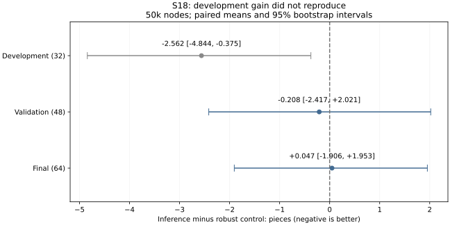

# 從公開七袋歷史推得唯一下一顆（S18）

保留已驗證cheese-robust，停止未通過新驗證的分層回傳調整。本輪使用
確定性的七袋知識，不再對七種未知方塊逐葉枚舉，也不重新訓練權重。

## 資訊與合法性邊界

標準七袋每袋恰有I,J,L,O,S,T,Z各一顆。若已公開同袋六種，剩餘一種
可確定推得。observer僅接收公開Color串流；沒有seed、RNG、隱藏佇列、
垃圾生成器或模擬器物件。初始化讀新局當前＋五預覽（六顆），每次鎖定
只加入新出現在預覽尾端的一顆；第一次向空Hold存入方塊時加入兩顆。
後續Hold交換不重複計入舊方塊。追蹤袋邊界，不能只看眼前六顆的集合。

推得唯一下一顆時，把它附加到搜尋queue，已知搜尋長度因此可能多一顆。
這是使用相同公開歷史作邏輯推論，**不是多開一格預覽**。對照也接收、
記錄相同公開資訊並執行推論，但不把推得方塊交給搜尋。兩版都維持相同
50k生成節點預算及遊戲規則，所有額外搜尋狀態照常計費。

僅支援已知從新袋開局的標準七袋遊戲。local race規則檢查恰有七種型別、
五預覽；不支援在未知袋起點的任意中盤初始化。其他用戶端目前未自動
接線，必須正確提供公開歷史。實驗只在headless race入口使用observer。
不因此宣稱與正式Jstris的所有RNG、規則及榜單條件完全等價。

## 正確性與公開紀錄稽核

單元測試遍歷全部5040個袋排列，檢查第七顆唯一推論；另測兩顆揭露跨袋
及異常串流停用推論，共68項引擎測試通過。初始標準袋對齊是API前提，
異常偵測不是用來猜測未知中盤的袋位置。

每個決策記錄原始可見queue六顆、Hold、公開揭露總數、剩餘型別mask及
推論種類，原始可見queue在附加推論之前記錄。audit_bag_observer.py
獨立從公開queue、Hold、實際inputs重建狀態，不使用seed或隱藏未來。
它檢查預覽的移動、首次空Hold的兩次抽取、每次推論及後續公開揭露，
並確認placebo的完整操作／清除序列與凍結基準一致。

最後一步沒有下一個決策事件，故其推論只作邏輯驗證，不冒稱已從事件
記錄確認實際揭露。原遊戲合法性另由獨立完整回放核對。

## 開發結果與鎖定

76000..76031，每版32/32完成，64份完整回放通過：

| 設定 | 平均方塊 | CPU秒／局 |
|---|---:|---:|
| observer placebo／凍結穩健決策 |197.1875|16.2937|
| 使用唯一推論 |194.6250|15.6867|

配對差−2.5625，95%bootstrap[-4.84375,-0.375]，21勝2平9敗。這是候選
選擇用的開發結果，不作泛化證據。全部32盤placebo操作與凍結基準相同。
1832次推論均由公開歷史核對，1818次另有後續揭露確認，14次最後一步
僅邏輯核對。這些推論不是1832個獨立遊戲樣本。

候選固定後，另開從未使用的76100..76147（三版各48盤）驗證：推論版、
observer placebo、較早learned-fast，全部交錯50k／4workers。先前75100
已用於S17，不能拿來作本輪新驗證。若候選完成率不差且平均同時低於兩
對照，才開75200..75263三版各64盤正式測試；正式對兩對照的配對95%
區間均全負且完成率不差才升級。若有失敗使配對樣本不完整，CI門檻
不予升級，避免完成者子集選擇偏差。不在結果後增加正式樣本或調參。

## 獨立驗證與正式結果（2026-11-14完成）

驗證76100..76147三版各48/48：推論195.645833、穩健placebo195.854167、
較早版198.125。相對穩健差−0.208333，95%區間[-2.416667,2.020833]。
僅通過預設平均門檻，未宣稱勝過穩健。144局完整回放通過；96局observer
公開歷史稽核2737次推論，其中2725次後續揭露確認、12次最後僅邏輯核對。

正式75200..75263，三版各64/64，候選／門檻皆在測試前鎖定：

|版本|平均方塊|CPU秒／局|
|---|---:|---:|
|cheese-quality／learned-fast|198.40625|16.72069|
|cheese-robust／observer placebo|195.00000|15.79206|
|七袋唯一推論|195.046875|15.51439|

推論−穩健為+0.046875，95%配對bootstrap[-1.90625,1.953125]，31勝6平27敗。
推論−較早版−3.359375，區間[-5.625,-1.15625]。**未通過雙控制升級門檻，
不替換cheese-robust。** 穩健−較早版−3.40625，區間[-5.671875,-1.140625]，
為既有穩健收益的獨立重現，不能歸因於新增七袋推論。

192局完整回放通過。128局公開歷史稽核3628次推論，其中3612次後續確認、
16次最後僅邏輯核對。較早版無observer事件，只有完整回放，不冒稱公開
歷史稽核。正式75200..75263已開封，不再調參、不擴樣本。

開發−2.5625、驗證−0.2083、正式+0.0469：這是開發優勢未重現，不能由
這些數字唯一判定過擬合、隨機波動或搜尋深度瓶頸。確定性推論正確也
不保證固定節點預算的完整策略更佳。保留實作及負面結果，不調推論規則。



重現正式判定與稽核：

```sh
python3 research/decide_cohort.py --lock research/results/s18-final-lock.json --inputs research/results/s18-final.jsonl --out-prefix research/results/s18-final --gate ci
python3 research/audit_bag_observer.py research/results/s18-final.jsonl --no-parity --out research/results/s18-final-public-audit.json
python3 research/replay_audit.py research/results/s18-final.jsonl --out research/results/s18-final-replay-audit.json
python3 research/plot_bag.py
```
