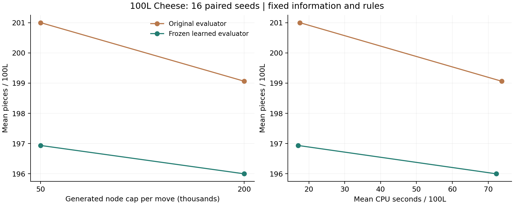
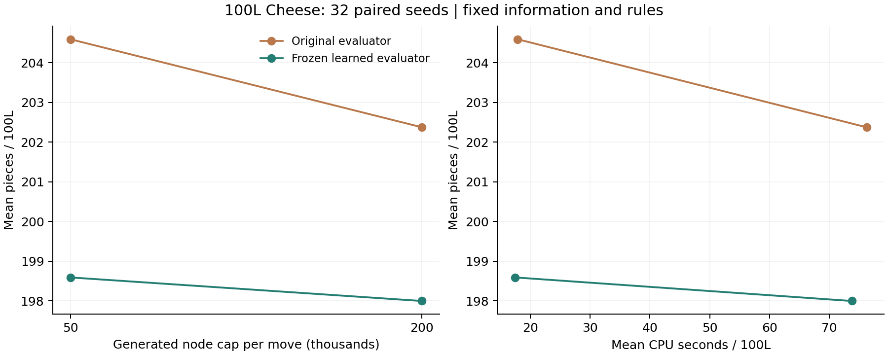

# 大預算與策略再評估研究

接續 [上一輪品質研究](QUALITY_REPORT.md)。本輪仍以完整 100L 方塊數與完成率為主，
CPU 成本為次；原 SRS、Hold、合法落點、五顆預覽與補垃圾規則皆保持不變。
上一輪正式測試 seed 20000–20099 不作任何調參。

## 預先定義的比較

- R1：新診斷盤面 50000–50015，原評估與凍結學習評估，各跑 50k、200k 累計
  生成節點／步。比較相同 seed 的方塊差，並檢查各策略增加預算的配對變化。
- R2：凍結學習策略在新 seed 6000–6159、5k 預算收集 160 局。
  6000–6127 訓練，6128–6159 選 ridge。特徵、標籤定義、每局等權重及非負係數
  約束與上一輪一致，唯一主要變因是產生訓練軌跡的策略。
- R3：學習評估配合僅終點分數的回傳方式；開發集 0–11，50k。
  與原本父節點／終點分數相加作比較，先單獨測試，不與重新擬合混用。
- R4：由已驗證操作回放匯出盤面特徵，量測實際執行狀態的預測誤差。
  這是觀察性診斷，不能代表所有搜尋葉節點或證明決策誤差的因果來源。

所有遊戲都沒有短時間期限；每局 600 秒逾時記失敗。固定工作量實驗可能同時
執行，CPU 是各子程序用量，牆鐘時間不能當成單獨執行效能。

## 重現工具

`bench.py` 保留每局 seed、參數、執行檔 SHA256、完整操作、逐步統計與 CPU/RSS。
`budget_summary.py` 強制各組同一批完整 seed，給出跨版本與跨預算的配對 bootstrap。
重新擬合新增 `fit_value.py --seed-start 6000`，另存權重，不覆蓋原品質模型。
`calibrate_replays.py` 透過 `--replay-features-out` 匯出資料，不重新搜尋或讀取隱藏資訊。
新版回放特徵已與原本即時收集的完整一局逐步核對一致。

本輪所有批次均已完整完成，沒有依中途平均值提前停掉較差結果。

## 已完成的候選篩選

| 實驗 | 開發 12 盤、50k 平均方塊 | 相對凍結學習版 | 決定 |
|---|---:|---:|---|
| 凍結學習版 | 198.083 | — | 比較基準 |
| R3：僅終點回傳 | 202.833 | +4.750 | 不採用；95% 配對 CI [−0.833, 11.167] |
| R2：新策略軌跡重新擬合 | 198.500 | +0.417 | 無改善證據；CI [−3.167, 4.750] |
| R5：16 步自舉目標 | 197.833 | −0.250 | CI [−4.167, 3.833]；進入 200k 驗證 |
| R8：依公開進度區分真正終點 | 198.000 | −0.083 | CI [−1.917, 1.417]；7/12 局方塊數相同，暫不採用 |

R2 在同一批 32 局模型驗證資料上的 Monte Carlo MSE 為 55.657，凍結模型為
55.806。不同資料集的 MSE 不能直接與上一輪 41.067 比較。這次小幅預測改善未
轉換成開發集方塊數改善，暫不替換既有品質設定。選中的 ridge 是 0.1，所有
權重另存 `policy2_weights.rs`，原本 `learned_weights.rs` 完整保留。

R7 將 R5 凍結後帶到 16 個診斷盤面的 200k 驗證：16/16 完成，平均 **195.688**，
凍結模型 **196.000**；配對差 **−0.313**，CI **[−3.438, 2.563]**，6 勝、1 平、9 負。
平均 CPU 為 76.23 秒／局，凍結模型 72.27。這不是可靠的新改善，**不升級預設品質
模型**；候選權重、執行檔與所有結果仍保留，避免把失敗實驗丟掉後只展示成功案例。
這也不是證明 TD 方法無效，只表示本次特徵、資料量與 16 步設定未獲支持。

R5 另以 16 步成本加凍結後繼盤面估值作訓練標籤，扣除期間新出現垃圾的預期
成本，仍用完整遊戲回報選 ridge。模型驗證 MSE 56.766；是否保留由完整遊戲決定。

品質設定與全 feature 組合各 61 項引擎測試已通過。新增回放匯出不更動 AI 搜尋。

R8 沒有揭露未知垃圾洞或未來方塊，只讀已清行數與當下可見垃圾量。
後續程式檢查補充：它仍沿用「底行被移除」的搜尋終點，沒有逐行追蹤垃圾顏色；
所以這是依公開進度調整終點獎勵的近似法，不能稱為精確的 100L 殘局求解器。
舊 API 行為保持原狀，新 `analyze_with_completion` 明確接收公開終點資訊。
新增測試驗證相同合法落點清掉可見底行時，中盤保留盤面成本、最後階段給完成獎勵；
品質設定現在共 62 項測試通過。重建原品質設定後，seed 0、3、8 的每步操作與
消行皆與凍結模型完全相同，seed 3 仍是 178 顆。
R8 逐步操作核對顯示有 5/12 局操作完全相同；另 2 局雖改變操作，最終方塊數相同。
其餘局改善與惡化並存（最好 −8、最差 +5），沒有穩定收益。詳見 `r8-divergence.json`。

## R1：預算診斷（16 個新盤面）

| 策略 | 50k 平均方塊 | 200k 平均方塊 | 200k 減 50k | CPU 秒／局，50k → 200k |
|---|---:|---:|---:|---:|
| 原評估 | 201.000 | 199.063 | −1.938 | 17.48 → 73.76 |
| 凍結學習評估 | 196.938 | 196.000 | −0.938 | 17.00 → 72.27 |

各組 16/16 完成。學習版的增加預算配對差 CI 為 [−3.000, 1.125]，原評估為
[−4.688, 1.250]；兩者都不能據這 16 盤斷言預算提升必然有效。相同 200k 下學習版
少 3.063 顆，CI [−7.125, 0.813]。50k 少 4.063 顆，CI [−8.250, −0.250]。
不能把兩組 CI 是否跨零當成「改善顯著縮小」的檢定；需要直接比較預算交互差。
直接計算 `(學習200k−原200k)−(學習50k−原50k)` 為 +1.000 顆，
CI [−2.563, 4.500]，同樣無法確定優勢是否隨預算改變。
完整原始與配對摘要保存在 `results/r1-budget-response.*`。

R4 已回放這 64 局。學習版 50k／200k 實際盤面的 learned-value MSE 分別為
69.58／85.36，原評估在相同盤面的 MSE 卻較低（37.23／47.80），即使它玩得較差。
其中標籤扣除的未知垃圾價格仍固定為原訓練局的 2.083984375；新策略整局成本降低，
也會造成殘餘成本標籤偏移。因此不能用這組 MSE 斷言搜尋葉節點被低估，更不能把
它直接當成動作排序品質。此結果推翻「整局回報擬合得更準就一定玩得更好」的簡化
假設；R2 的近乎持平也沒有支持僅重收軌跡就能穩定改進。



## R6：正式獨立預算比較

凍結同一對執行檔，在全新 seed **51000–51031** 上比較。200k 組先鎖定，
只查看完成狀態、未查看方塊數彙總時，加入同 seed 的 50k 對照；詳見協定時間順序。
兩批皆完整執行，沒有根據顯著性追加盤面。四組各 **32/32 完成**。

| 每步累計生成預算 | 原評估平均方塊 | 學習評估平均方塊 | 學習減原評估，95% 配對 CI |
|---|---:|---:|---:|
| 50,000 | 204.594 | **198.594** | **−6.000** [−9.375, −2.656] |
| 200,000 | 202.375 | **198.000** | **−4.375** [−7.500, −1.250] |

主要結論：**原有學習評估的改善在四倍搜尋預算下仍維持**，200k 減少約 2.16%，
23 勝、1 平、8 負。但目前沒有證據顯示優勢會隨預算擴大。

- 學習版從 50k 到 200k：**−0.594 顆**，CI **[−3.656, 2.406]**，
  14 盤改善、1 盤持平、17 盤惡化。增加搜尋並不保證降低單局方塊數。
- 原評估從 50k 到 200k：−2.219 顆，CI [−5.813, 1.344]。
- 直接比較兩版優勢的預算交互差：**+1.625 顆**，CI **[−3.031, 6.094]**。
  點估計的優勢縮小，卻不足以確認縮小，更不能宣稱擴大。
- 學習版平均 CPU **17.44 → 73.76 秒／局**（約 4.23 倍），原評估
  **17.85 → 76.25 秒／局**。200k 尚未顯示相稱且確定的方塊收益。

區間使用 10,000 次配對 bootstrap、固定亂數 seed 173，未作多重比較校正。
200k 的同預算版本比較是主要問題；其餘預算比較與交互差提供診斷。
同一批 32 個 seed 跑四組，不能稱為 128 個不同測試盤面。



## 保留版本、驗證與研究限制

**保留原 `cheese-quality` 學習權重**；不把 R2、R5 或 R8 的小幅開發集差距升格
為新成果。新候選只作顯式實驗 feature，皆有獨立權重、建置雜湊與完整失敗紀錄。
沒有改 SRS、Hold、合法落點或七袋／垃圾生成規則。

本輪共完成 **419 場完整 100L**（含 160 場訓練資料收集，220 個不同 seed），
所有 **419/419 操作回放通過**，子程序 CPU 合計約 **3.10 小時**。
工作區 67 項測試、品質設定 62 項、全實驗 feature 61 項引擎測試通過。
三個模型重擬合最大係數差均為 0；品質設定的 3 局操作與舊版逐步相同。

目前尚未跨過的瓶頸，是如何讓成本估計的改變可靠轉換成更好的動作排序。
本輪較多搜尋、重收軌跡、16 步訓練與終點修正均未證實能在既有學習版上再進步。
這不排除更好的策略評估、搜尋方法或高預算訓練資料；它只限制本輪已測試方法的
結論。下一輪應將「動作差值／搜尋葉節點的價值」與「整局回報擬合」分開驗證，
並使用新的正式測試 seed，不能繼續調整後重用 51000–51031 作獨立證據。

最低已驗證本機結果仍是 **178 顆**，這輪沒有刷新紀錄。
原模擬器與現行 Jstris 的 RNG／規則完整對照、官方最強紀錄核定仍未完成，
所以本輪結果不構成 Jstris 世界紀錄聲明。

## 重現本輪

先啟用 Rust 環境並進入專案。以下使用既有 `measure` 記錄子程序 CPU/RSS：

```bash
source /workspace/.blockfish-env/activate.sh
cd /workspace/blockfish
python3 research/build.py quality-baseline learned-fast
cc -O2 -Wall -Wextra research/measure.c -o research/bin/measure
python3 research/bench.py --binaries research/bin/quality-baseline research/bin/learned-fast \
  --configs 50/5,10,10,10 200/5,10,10,10 --start 51000 --count 32 \
  --jobs 4 --timeout 600 --out research/results/reproduce-r6.jsonl
python3 research/budget_summary.py research/results/reproduce-r6.jsonl \
  --expected-count 32 --budget-interaction --out research/results/reproduce-r6.summary.json
python3 research/replay_audit.py research/results/reproduce-r6.jsonl \
  --out research/results/reproduce-r6-replay.json
```

重新收集與擬合候選（不要覆蓋凍結的 `learned_weights.rs`）：

```bash
python3 research/bench.py --binary research/bin/learned-fast --configs 5/5,10,10,10 \
  --start 6000 --count 160 --jobs 4 --collect-features --out research/results/reproduce-r2-data.jsonl
OPENBLAS_NUM_THREADS=1 python3 research/fit_value.py --seed-start 6000 \
  --data research/results/reproduce-r2-data.jsonl --report research/results/reproduce-r2-fit.json \
  --weights-out blockfish-engine/src/ai/policy2_weights.rs
OPENBLAS_NUM_THREADS=1 python3 research/fit_value.py --seed-start 6000 \
  --data research/results/reproduce-r2-data.jsonl --bootstrap-fit research/results/value-fit.json \
  --horizon 16 --report research/results/reproduce-r5-fit.json \
  --weights-out blockfish-engine/src/ai/td_weights.rs
python3 research/build.py learned-policy2 learned-td learned-terminal learned-race-goal
```

所有原始結果位於 `research/results/r*.jsonl`；`r6-final.summary.json` 包含正式配對
統計與執行檔 SHA256，`r-development-replay-audit.json`、`r6-final-replay-audit.json`
保存每份操作 trace 的核驗紀錄。`r-resource-summary.json` 列出本輪精確資料來源。
