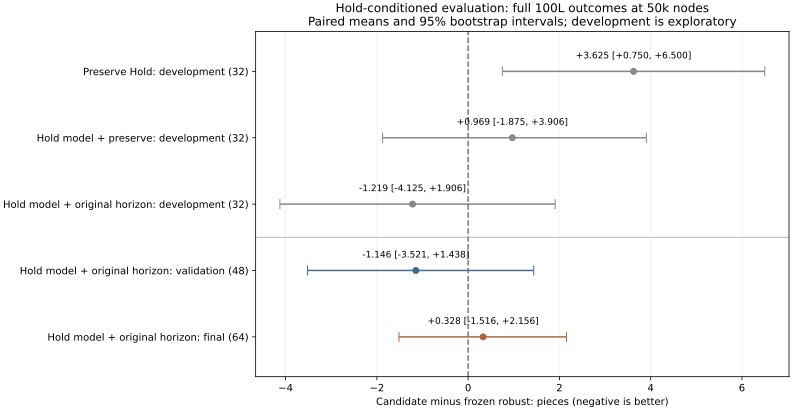

# S20–S23：Hold 條件估值與標籤噪音

最終結果：S22未通過正式雙控制門檻，**仍保留cheese-robust**。候選在正式64盤
平均196.546875塊，穩健版196.21875；差+0.328125，95%區間跨零。
本輪新增601局（含訓練、策略測試與等價性檢查）全部完成及回放通過，
合計8033.86 CPU秒；336個不同seed ID，不是601個獨立種子。

延續 S19 的表示限制，檢查只有盤面特徵的估值是否需要 Hold 條件修正。
不再掃描搜尋邊界或增加節點預算，可靠基準 cheese-robust 保持不變。

## 資料與固定模型

`BoardSample` 新增公開的 `hold: Option<char>`，來源是當下 Snapshot，
不讀未來方塊或 RNG。新 `context-source` 使用原 cheese-quality；3盤
完整操作／消除序列與凍結 learned-fast 一致。76400..76559 共160個新
種子，以5k節點來源策略完整玩100L，全部完成並由凍結程式回放通過。
前128盤76400..76527訓練，後32盤76528..76559檢查預測。

模型是七種 Hold 的中心化 one-hot，與既有盤面特徵
`[bias,height,piece_estimate,i_dependencies,wells]` 的交互項。每盤總權重
相同；RMS尺度只從訓練資料估計；ridge固定10，沒有參數掃描。空 Hold
修正固定零，七種類型的修正平均固定零。原盤面權重不動。這不能消除
策略選擇 Hold 所造成的觀察性混淆，不能解讀成更換 Hold 的因果效果。

排除尚未可見垃圾少於20行的收尾樣本；使用訓練盤平均每行成本2.027109375
調整不可見垃圾。隱藏未來只出現在離線回報標籤，模型輸入只有盤面及 Hold。
18,995個訓練狀態仍只來自128個獨立遊戲；信賴區間按遊戲重抽樣。

## S20：整局回報

標籤為實際剩餘方塊數減去尚未可見垃圾的平均成本。擬合相對凍結盤面
估值的殘差，不重新訓練盤面係數。

|集合|遊戲數|原MSE|修正MSE|
|---|---:|---:|---:|
|訓練|128|38.312537|38.176328|
|獨立預測驗證|32|40.284986|40.325747|

驗證差+0.040761，95%遊戲bootstrap[-0.151956,0.245482]。
**未通過預先設定的平均預測門檻；不接入策略。**

## S21：固定七步標籤

為檢查長期回報噪音，固定使用七步成本加七步後的凍結盤面估值，按
期間可見垃圾變化作同樣調整。七步由七袋長度事先決定，沒有步數掃描。
使用相同128盤訓練，但另收全新76600..76631的32盤作預測驗證，全部
完成且回放通過。沒有再次使用S20已看過的驗證集調整模型。

|集合|遊戲數|原MSE|修正MSE|
|---|---:|---:|---:|
|訓練|128|2.770994|2.695545|
|新預測驗證|32|2.735080|2.722706|

驗證差−0.012374，95%遊戲bootstrap[-0.041443,0.017138]。僅通過預設的
平均門檻，區間跨零。兩輪標籤不同，不能把MSE絕對值下降當成策略收益。
七步標籤也繼承凍結估值的偏差，因此這不是直接量測真實剩餘成本誤差。
凍結權重後進入完整100L開發試驗；預測誤差本身不作升級依據。

## 實作與適用限制

新增 optional `hold-context`，與 cheese-robust、preserve-hold 明確組合為
`robust-hold-context`。每次估值在原盤面cache之外加上公開Hold修正，
避免同盤面不同Hold污染cache。`State::held_color()`區分真正Hold與
空Hold時可交換的第二預覽。68項測試通過，包括空Hold、預覽耗盡後仍
保有Hold、七種修正平均為零。推論分數以既有十分之一方塊單位量化。

這仍有訓練／搜尋分布差異：訓練是真實current+5預覽的策略狀態，搜尋
葉可能只剩Hold。實際效果必須由完整對局決定。開發固定76000..76031、
50k生成節點，同時比較凍結robust與S19保留Hold版本；比較CPU僅描述，
對照是較早批次。候選必須平均勝過兩者才進新策略驗證集。

## 重現

```sh
source /workspace/.blockfish-env/activate.sh
python3 research/build.py context-source
python3 research/bench.py --binary research/bin/context-source --configs 5/5,10,10,10 --start 76400 --count 160 --jobs 4 --collect-features --out research/results/s20-data.jsonl
python3 research/fit_hold.py
python3 research/bench.py --binary research/bin/context-source --configs 5/5,10,10,10 --start 76600 --count 32 --jobs 4 --collect-features --out research/results/s21-data.jsonl
python3 research/fit_hold.py --td7
python3 research/build.py robust-hold-context
cargo test --locked -p blockfish --lib --no-default-features --features race,cheese-robust,hold-context,preserve-hold
python3 research/bench.py --binary research/bin/robust-hold-context --configs 50/5,10,10,10 --start 76000 --count 32 --jobs 4 --out research/results/s21-dev.jsonl
python3 research/decide_cohort.py --lock research/results/s21-dev-lock.json --inputs research/results/s16-control-dev.jsonl research/results/s19-dev.jsonl research/results/s21-dev.jsonl --out-prefix research/results/s21-dev --gate mean
```

## S21完整對局結果

32/32完成，候選198.15625塊、凍結robust197.1875、S19保留Hold200.8125。
相對robust差+0.96875，95%配對區間[-1.875,3.90625]，13勝3平16敗。
相對S19差−2.65625，區間[-5.34375,0.0625]，20勝2平10敗。
**沒有勝過可靠基準，拒絕升級。** 不能因勝過較弱的S19而宣稱改進。
32份回放全部通過。候選CPU25.813秒／局，對照15.666／16.883秒／局；
額外特徵計算有成本，未投入加速，因尚未證明方塊數收益。

## S22：相同權重、原本搜尋終點

另作固定權重的結構消融：保留原本放完已知Hold的終點，只加Hold條件
修正，profile為robust-hold-order。hold-context不再隱含preserve-hold依賴；
S21profile明確指定兩者，因此S21凍結二進位和行為不變。新profile的
68項測試通過；s22-dev-lock記錄與S21完全相同的權重hash。

正常的耗盡預覽終點已沒有Hold，因此作用主要在中間節點排序和父節點
平滑分數。不能稱為純搜尋排序消融，因parent_f也參與終點rating。
相同76000..76031、50k；不得看結果後調權重。需勝過原robust與S21才
進新策略驗證。單獨改變葉邊界已失敗，不再把較弱對照作升級標準。

S22開發32/32：195.96875 vs robust197.1875，差−1.21875，95%區間
[-4.125,1.90625]，21勝2平9敗；相對S21−2.1875，區間[-4.78125,0.4375]。
通過預設篩選，但區間跨零且此32盤已用於多輪開發，不能當泛化證據。
32回放通過，另3局來源parity回放也通過。

候選固定後，開NEW76200..76247：候選、凍結robust、較早learned-fast
三版各48盤，交錯4workers50k。需完成率不差且平均同時低於兩對照才
開75300..75363三版64盤正式；正式要求對兩對照配對95%區間全負且
64配對均完成。不得看正式結果後擴樣本。這是同生成節點預算比較，
不宣稱相同CPU或牆鐘成本；成本另外記錄。

候選快照 `checkpoints/s22-candidate-20261114-source.tar.gz` 已實際解壓，
離線locked重新編譯，得到與凍結候選完全相同的二進位SHA256；詳見
`results/s22-restore-check.json`。快照與manifest明確標為未升級候選。

## S23：精確快取成本試驗

正式S22期間另做optional hold-context-cache，不替換正式測試執行檔。
每個analysis快取盤面對應七種Hold修正；各類型使用原correction函式與
相同算術次序，且每次新analysis清空，避免跨盤面／Hold錯用估值。
69項測試通過。正式release建置另確認未使用僅測試可用的Color建構函式。

76000..76002，兩版交錯單worker，三盤全部完整inputs/ds/搜尋計數相同，
6局回放通過。CPU平均22.6282→20.3059秒（小型試驗約10.3%減少），
平均峰值RSS26209→30996KiB。其他固定節點批次同時執行，僅作先導
成本觀察，不宣稱普遍速度比；也不把相同方塊數包裝成品質提升。
沒有再投入快取微調；是否保留策略仍由原候選的正式對局決定。

```sh
python3 research/build.py robust-hold-cached
python3 research/bench.py --binaries research/bin/robust-hold-order research/bin/robust-hold-cached --configs 50/5,10,10,10 --start 76000 --count 3 --jobs 1 --out research/results/s23-parity.jsonl
python3 research/audit_context_cache.py
```

## S22正式結果與處置

新驗證76200..76247：候選196.6875、robust197.833333、legacy198.354167，
三版各48/48，144回放通過。相對robust差−1.145833，95%[-3.520833,1.4375]；
相對legacy差−1.666667，95%[-4.375,1.125]。僅通過事先平均篩選門檻。

之後固定候選，在75300..75363三版各64盤正式測試：

|版本|完成|平均方塊|CPU秒／局|
|---|---:|---:|---:|
|較早learned-fast|64/64|198.671875|16.57855|
|可靠cheese-robust|64/64|196.218750|15.76630|
|S22 Hold條件候選|64/64|196.546875|22.47724|

候選−robust為+0.328125，95%配對bootstrap[-1.515625,2.15625]，27勝6平31敗。
候選−legacy為−2.125，區間[-4.25,0.0]。兩個嚴格區間門檻都未通過，
且候選平均未勝robust。**不升級，不擴正式樣本，不混入開發／驗證挽救。**
192回放全部通過；逐步搜尋紀錄與trace一致、長度與方塊數一致，預算無超標。

同一正式集robust−legacy為−2.453125，區間[-4.171875,-0.671875]，再次支持
已保留穩健策略的收益。這不能歸因於新增Hold模型。僅限本地模擬器50k，
不是官方Jstris紀錄，也不是同CPU時間比較。

正式揭露前已規定：只有通過才做200k預算後續。此條件未成立，因此沒有
啟動200k來挽救結果。候選和S23快取都保留為研究版本，不設為推薦設定。
新的76700..76747策略驗證及75400..75463正式集仍未使用。



## 結論與下一個技術問題

短期標籤讓預測誤差稍降，加入原搜尋邊界後開發／驗證均有約一塊的
平均改善，但正式沒有重現。區間仍容許小收益或小退步；不能據此證明
唯一原因就是過擬合，也不能宣稱「只要加入Hold就更好」。較弱的S19
對照、預測MSE、較低CPU成本，都不能取代對可靠基準的完整對局證據。

已停止這組觀察性Hold殘差模型的係數／正則／步數／邊界調整。下一個
可研究的問題是如何為實際搜尋葉或少量根候選取得條件成本標籤，使用
公開七袋條件與共同隨機樣本，沿用原模擬器。需另外驗證資訊合法性、
候選排序品質與完整對局，不可把現有完整預覽狀態的回報直接當葉的真值。
這些方向尚未實作，不宣稱改善。

```sh
python3 research/decide_cohort.py --lock research/results/s22-final-lock.json --inputs research/results/s22-final.jsonl --out-prefix research/results/s22-final --gate ci
python3 research/replay_audit.py research/results/s22-final.jsonl --out research/results/s22-final-audit.json
python3 research/plot_context.py
```

所有新增對局的完成／回放及成本彙總見results/s20-s23-completion.json。
