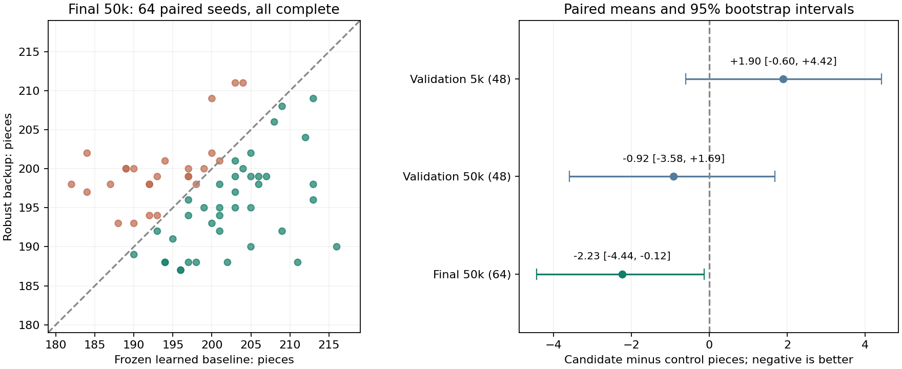

# 泛化診斷與穩健回傳研究

接續 [搜尋研究](SEARCH_REPORT.md)，保留已驗證的 `cheese-quality` 作為可靠基準。
研究開始時封存62200..62263；之後依預先規則完成正式測試，結果見下文。
新驗證集75000..75047只在候選固定後開啟。

## S9失敗：證據與不能推論的事

直接優化使用32個種子、49個自適應產生的候選，依同一組完整遊戲平均數
選出權重，沒有額外的獨立模型選擇集。每次都完成32盤雖避免了早停偏差，
仍無法避免多次選擇對有限樣本的適應。1,568局實際只有32個獨立環境。

固定候選在相同5k預算：訓練平均差−7.53125，獨立驗證+2.21875，相差9.75塊。
訓練配對差標準差12.7734，獨立驗證9.0544。訓練中六盤合計少170顆，佔
全部241顆淨收益70.5%。不能因此刪除這些盤；它們揭示平均值容易受少數
大幅路徑改變影響。前16／後16訓練盤分別改善9.0625／6顆，但兩半都參與
候選生成，不能冒充獨立驗證。既有策略在訓練盤本身也較難：205.71875，
驗證盤201.53125，因此抽樣差異與選擇偏差都可能參與，現有證據不能分離。

`diagnose_generalization.py`保存配對差、極端盤面及診斷。條件式bootstrap
泛化差區間[4.5625,15.21875]沒有修正49次自適應選擇，只作描述，不作
正式推論。50k驗證的新模型差−0.40625、區間跨零，因此也不能簡稱為
「低預算模型不適用高預算」：同預算本來就沒有可靠泛化。

另一個基本限制是盤面回歸並不直接等於搜尋決策品質：14個特徵只描述盤面，
不描述剩餘預覽與Hold；已知方塊透過搜尋使用。B*將各第一步的最低終局
分數回傳，有機會選到估值偏差恰好樂觀的孤立路徑。這是要測試的機制假設，
不是已經證實的失敗根因。先前排序回歸、擴大搜尋與小幅權重收縮已失敗，
因此這輪固定模型，測試回傳方式，而不再微調那六個權重。

## S11：多個不同終局支持第一步

沿用原B*展開順序、SRS、Hold、可見資訊、既有學習估值。每個第一步保存
分數最低的四個不同終局State（盤面、佇列、Hold等完整狀態相等時去重），
以平均分數排名第一步；不足四個就使用已找到的終局。評分可隨加入較差
支持而上升，搜尋結果接收端必須收到這種更新。實際回傳該第一步的最佳
合法序列。原有最短底行完成偏好保留。所有生成節點仍計入50k上限。

四個終局都是可控制的後續選擇，平均分數**不是**未知未來的無偏期望，
也不是chance-node搜尋；它只測試不依賴單一路徑的啟發式是否有用。
模型不重新訓練，固定四個的設定不在開發集上搜尋。

新增單元測試確保同一終局的重複路徑不增加支持、平均分數能上升、較佳
同狀態路徑更新、只保留最佳四個、既有底行目標偏好不被平均淹沒。65項測試通過。
12盤開發集全部完成並通過回放，平均195.3333 vs196.9167，差−1.5833，
95%配對區間[-4.8333,1.9167]，6勝1平5敗。僅足以進入新48盤驗證，
不據此取代基準。新驗證以兩版交錯執行，固定50k，不看中途結果調參。

另做實作對照：收集相同四個終局，仍取最低分，使用相同的四倍整數刻度。
在開發集核對完整操作序列；用來隔離平均回傳與記錄／縮放的影響。

初始盤面搜尋稽核：12/12盤的frontier、生成節點及完整序列數完全一致，
其中3盤第一步不同。支持改動限於回傳選擇，而非擴大搜尋或增加資訊。

實作對照完成12/12盤：平均196.9167，且每盤完整操作與清除序列均與
凍結基準完全相同。分數縮放與收集支持終局本身沒有改變這批決策。
對照設定64項測試通過，12份回放通過。

## S11獨立驗證與正式鎖定

75000..75047共48個新種子，兩版各48/48完成、96份回放全部通過。
凍結基準197.47917，穩健回傳196.56250，差−0.91667，配對95%區間
[-3.58333,1.68750]，22勝3平23敗。每局CPU17.0166／16.4038秒。
開發與驗證方向一致，但勝負並非單方面，區間仍包含零，不能視為證實。

依事前固定門檻（完成率不差且平均較低），進入原先封存的正式集
62200..62263，兩版各64盤、50k生成節點、4個交錯worker，不並行其他
對局實驗。程式與權重固定。正式集只做這一次候選確認，不加樣本、不調參。
只有正式配對區間完全小於零且完成率不差，才升級；否則保留為未證實
分支，即使合併開發／驗證結果看起來較好也不取代這個判準。

正式50k測試結果開啟前另登記低預算診斷：之後在同一48盤驗證集重跑5k，
比較配對的預算交互作用。目的在檢查支持終局數是否限制此策略；它不能
代替正式證據，也不能用來調整平均的個數或挽救未通過的正式結果。

附：官方[API文件](https://jezevec10.github.io/jstris-api-docs/)提供Cheese
排行榜及單局blocks/replay欄位的查詢方法，但本次排行榜頁存取失敗，
尚未確認當前最低方塊紀錄。官方[指南](https://jstris.jezevec10.com/guide)
不足以核對完整垃圾生成與RNG實作，因此仍只報告本地模擬器的改善，
不宣稱官方Jstris紀錄或完全規則等價。

目標語意補充：S11保留原B*清除搜尋盤面底行的特殊分數，並沒有把它
改成精確100L完成判定；完整100L完成率仍由實際遊戲模擬器判斷。S8的
精確待清垃圾追蹤是另一條分支，本次未合併，以免混淆因果。

## S11正式結果：保留為50k品質版本

原封存62200..62263完整64盤，每版64/64完成。

| 設定 | 平均方塊 | CPU秒／局 |
|---|---:|---:|
| 既有learned-fast |199.156250|17.29569|
| 固定learned-robust |196.921875|16.49550|

配對差−2.234375，95% bootstrap區間[-4.4375,-0.125]，39勝2平23敗。
符合事前升級門檻，新增`cheese-robust`設定；原`cheese-quality`與凍結
執行檔完全保留。區間接近零，樣本只有64個環境，不誇大為穩固大幅
優勢，也不宣稱超越官方紀錄。正式集已使用完畢，未追加樣本。

128份正式回放全部通過；種子、執行檔hash、遊戲設定、逐步≤50k節點
亦通過audit_s11_final.py。正式測試共2162.64 CPU秒。

### 低預算的適用範圍診斷

同48盤驗證集75000..75047、5k節點，兩版48/48完成、96份回放通過：
原模型202.5000、新模型204.3958，差+1.8958，95%區間[-0.6042,4.4167]。
50k相對差減5k相對差為−2.8125，95%區間[-6.625,0.8125]；點估計
隨預算變化，但不能排除抽樣誤差。因此只推薦經正式驗證的50k設定，
不將低預算較快的CPU成本當成進步，也不依此調整k。

重現指令（先啟用工作區Rust環境）：
```sh
python3 research/build.py cheese-robust
python3 research/audit_s11_final.py
python3 research/budget_summary.py research/results/s11-validation.jsonl research/results/s11-low-validation.jsonl --expected-count 48 --interaction-variants learned-fast learned-robust --out research/results/s11-budget-summary.json
```

## S12：先覆蓋第一步，搭配平均回傳

不是繼續調權重。假設是先前只對最低分回傳有害的根節點覆蓋，可能
在平均回傳下改善支持不足的問題。直接結合既有root-complete與穩健
回傳，不調整其餘參數；完整評估各第一步至少一條預覽序列後才做
全域改進。先跑相同12盤開發集、50k，與新舊兩個基準比較。
新驗證預留75100..75147、後續正式預留75200..75263，不再使用62200調參。

### S12結果

12/12完成，覆蓋＋穩健平均197.0000，穩健單獨195.3333，差+1.6667，
95%區間[-3.1667,6.6667]。未通過開發門檻，不進驗證、不再微調覆蓋。
每局CPU18.2482秒對16.0391秒，額外探索未帶來方塊收益。
66項測試通過，完整12份回放通過。

新增cheese-robust建置與凍結候選在62000、62003、62008的完整操作、
清除序列一致。源碼快照與hash清單存於research/checkpoints/，原基準
與凍結候選執行檔保留；以50k而非5k作為此設定的已驗證使用預算。

## S13：穩健中盤＋精確殘局

使用既有endgame-wide，不修改其界限、觸發條件或1/5預算分配。
只有最後最多7行垃圾已全部可見才嘗試，以現有SRS、Hold及已知預覽
求精確收尾；找到的序列完整執行，失敗將未使用節點交回B*。
12盤開發集與穩健基準比較，若無改善則不升級。

### S13結果與保存狀態

12/12完成且全部同方塊數，兩版平均195.3333；無額外方塊收益，
不因CPU略降（15.6482 vs16.0391秒）而升級。69項測試及12份回放通過。

S11–S13共371局全部完成、全部通過回放，涵蓋124個獨立種子；多版本
及多預算重跑不能算作371個獨立環境。正式改進保留為cheese-robust，
後續兩個組合均不採用。75100..75147和75200..75263尚未開啟。
源碼快照已實際解壓並以locked/offline方式成功編譯，並保留凍結binary
及hash清單，詳見checkpoints/s11-20261113-manifest.json。

目前證據支持改變終局選擇方式能在50k降低方塊數，不能據此斷言
過度樂觀回傳是所有過度擬合的根因。低預算效果仍未證實；額外根
覆蓋及既有精確殘局也沒有帶來收益。下一輪應檢驗新的預覽邊界／
未知未來建模假設，或以更多獨立訓練環境約束策略選擇，避免繼續
在相同小樣本上搜尋權重、平均個數或反覆組合同一批失敗分支。



圖表由plot_robust.py從完整原始結果產生；正式集與驗證集分開呈現。

後續已實作兩種預覽邊界延伸，均未改善，見[完整負結果](TAIL_REPORT.md)。
