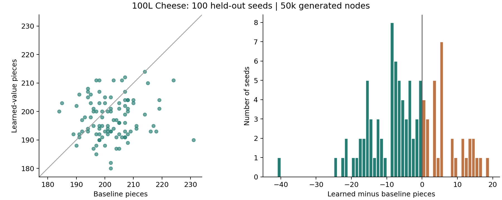
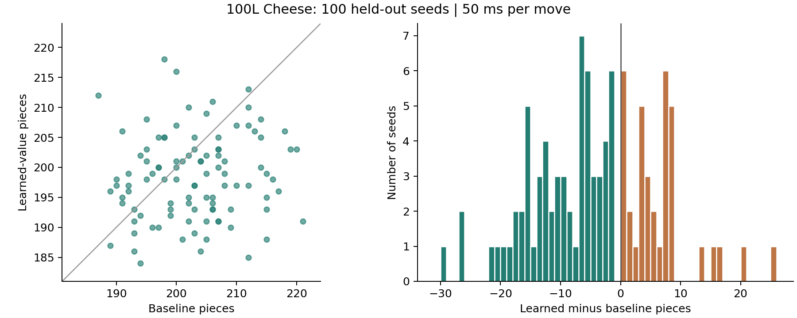

# 以方塊數為目標的 Blockfish 改進

後續已完成 [大預算與策略再評估研究](BUDGET_REPORT.md)：32 個新盤面的 200k
比較仍支持原學習版，但未證實增加預算或本輪新候選能進一步降低方塊數。

本報告接續 [第一階段實驗](REPORT.md)。第一階段的等價效能改善已保留為研究基礎，
但單純加速在同時間測試只少 0.46 顆且信賴區間跨零，因此不能算作方塊數改進。

本階段的候選是 **保留原 B* 搜尋，使用離線學習的盤面剩餘成本評估**。
原版 SRS、落點生成、Hold、七袋、5 顆預覽和實際遊戲模擬都沿用原專案。
模型只讀盤面；搜尋仍只讀當前方塊、已知預覽和 Hold，沒有取得 seed 或未來資訊。

## 學習方法

用原策略在 160 個分開產生的盤面上完成 100L，記錄每步公開盤面與最終方塊數。
其中 128 個 seed（3000–3127）訓練，32 個 seed（3128–3159）選擇 ridge 強度；
不能將同一局的不同步驟拆到訓練與驗證兩邊。

模型目標是：

`該步之後實際所需方塊數 − 訓練集每條垃圾行的平均成本 × 尚未出現的垃圾行數`

未來的遊玩結果只作為訓練標籤，不作為執行時輸入。只取仍有至少 20 條未出現垃圾的
中盤樣本，避免把比賽結束後殘留方塊的特殊價值混進一般盤面估值。每局總權重相同。
實際使用 19,661 個訓練樣本、4,892 個模型驗證樣本。

候選特徵包括原版殘留方塊估計、I 依賴、高度、洞、被覆蓋的行、行／列轉換數、井等。
使用非負線性係數（截距除外），以降低不合理外插；沒有引入外部 API 或神經網路依賴。
模型驗證 MSE 從原評估的 54.204 降到 41.067，但採用與否仍由完整遊戲的方塊數決定。
係數和擬合過程保存在 `results/value-fit.json`、`fit_value.py`、
`blockfish-engine/src/ai/learned_weights.rs`。

## 各輪實測

以下固定節點比較均採 **累計嘗試生成節點**，包含根、重複節點和被剪掉的分支。
沒有給剪枝版額外的隱藏搜尋量。預算、遊戲規則和可見資訊保持一致；不設短期限。

| 輪次／假設 | 條件 | 結果／決定 |
|---|---|---|
| Q1：保留最後 Hold，不強制放完 | 開發 12 盤，50k | 205.33 vs 基準 204.00，未改善 |
| Q1：所有 beam 葉節點按終點分數評分 | 同上 | 203.92，幾乎無差異 |
| Q1：beam 保留不同的完整狀態 | 同上 | 202.58，僅小幅初步優勢 |
| Q2：更寬的 beam／Hold I 折扣 | 同上 | 加寬去重 beam 234.50；最寬版 0/12 完成；I 折扣沒有穩定改善 |
| Q3：跨第一步合併等價狀態 | 開發 12 盤，50k | 197.67 vs 204.00，看似少 6.33 顆 |
| Q4：全域去重跨盤面驗證 | 新 24 盤，50k | 203.25 vs 202.29，反而多 0.96 顆；淘汰，不把開發集領先當成果 |
| Q5：共享去重狀態降低成本 | 兩盤串行 CPU／操作核對 | 約 32.47→31.80 CPU 秒，效果很小；不優先投入 |
| Q6：學習評估／與原版各半混合 | 開發 12 盤，5k | 純模型 203.00，混合 202.33，基準 211.25；全數完成 |
| Q7：增大預算及與全域去重組合 | 開發 12 盤，50k | 純模型 198.08；混合 201.67；去重＋混合 198.92；基準 204.00 |
| Q8：等價位元特徵計算 | 5,000 隨機盤面＋3 局完整操作 | 特徵值、消行與操作序列完全一致；用來降低新評估的成本 |
| Q9：純模型／混合模型跨盤面驗證 | 新 24 盤，50k | 純模型 197.21、混合 198.92、基準 202.29；選純模型 |
| Q10：另 128 盤低預算配對對照 | seed 40000–40127，5k | 純模型 202.81 vs 基準 207.85；兩者 128/128 完成 |
| Q11：凍結模型的單局預算掃描 | 已選中的開發 seed 3，1k–50k 共 12 組 | 全數完成並回放通過；最低仍為 178，沒有因首次勝出就停止探索 |

Q9 純模型配對差（模型減原版）為 **−5.083 顆**，95% paired bootstrap CI
**[−9.042, −1.542]**。混合版為 −3.375，CI [−6.875, 0.042]。
因此在查看正式測試集之前，選定純模型，排除全域去重、beam 與 Hold 改動。

Q10 是紀錄搜尋完整批次的事後基準補跑，沒有挑掉較差盤面；它不是預先指定的正式
測試集。128 盤配對差為 **−5.039 顆**，CI **[−6.734, −3.383]**，作為補充證據。
不能拿單一最好盤面或不同 seed 的平均值來冒充配對改善。

## 正式獨立測試

已在 [PROTOCOL.md](PROTOCOL.md) 預先鎖定種子 **20000–20099**、模型、權重與策略。
執行 50k 固定生成預算及 50ms/步兩組比較，兩者均為完整 100L、100 組配對。
固定預算組已完成，沒有使用測試結果調參：

| 50k 累計生成節點／步 | 原評估＋等價加速 | 學習評估 |
|---|---:|---:|
| 完成率 | 100/100 | 100/100 |
| 平均方塊數 | 202.23 | **197.56** |
| 中位數 | 202 | 196.5 |
| 最少／第 95 百分位 | 184 / 217 | 180 / 211 |
| 平均 CPU 秒／局 | 17.109 | 16.793 |
| 平均 CPU 毫秒／方塊 | 84.603 | 85.004 |
| 批次最大 RSS MiB | 34.32 | 30.23 |

配對平均差為 **−4.67 顆（−2.31%）**，95% bootstrap CI **[−6.73, −2.60]**。
100 個相同 seed 中，學習版 67 勝、4 平、29 負。兩版每步都恰好生成 50,000 節點。
每顆方塊的 CPU 成本沒有下降；整局較省時間主要來自使用較少方塊。
CPU 數字是四工作程序下各子程序的 CPU 用量，並非單獨串行微基準。

原始資料為 `results/quality-final-fixed.jsonl`，統計摘要為同名 `.summary.json`。
相同 50ms／步軟期限、最多 50k 累計節點的結果：

| 50ms／步 | 原評估＋等價加速 | 學習評估 |
|---|---:|---:|
| 完成率 | 100/100 | 100/100 |
| 平均方塊數 | 202.96 | **198.40** |
| 中位數 | 203 | 198 |
| 最少／第 95 百分位 | 187 / 216 | 184 / 210 |
| 平均 CPU 秒／局 | 9.995 | 9.791 |
| 平均生成節點／步 | 30,258.7 | 29,967.6 |
| 實際平均搜尋毫秒／步 | 50.147 | 50.150 |
| 批次最大 RSS MiB | 26.40 | 26.80 |

配對平均差 **−4.56 顆（−2.25%）**，95% bootstrap CI **[−6.58, −2.55]**，
64 勝、6 平、30 負。軟期限每 64 個搜尋步驟檢查，且至少先產生一個完成候選；
不應解讀為整步執行時間的硬上限。計時決策受排程影響，重跑不保證逐步一致。
原始資料為 `results/quality-final-timed.jsonl`，同名摘要保存完整成本與執行檔雜湊。
兩組使用同一批 100 個獨立 seed，不能算成 200 個不同測試盤面。




使用 `replay_audit.py` 將兩組共 **400/400** 場操作回放，逐步消行與完整 100L
皆通過。稽核檔為 `results/quality-final-replay-audit.json`，包含每份 trace 的 SHA256。
工作區 66 項測試、品質設定的 61 項引擎測試與所有實驗 feature 的 61 項引擎測試
均通過；另有 5,000 個隨機盤面的特徵等價測試。

## 單局紀錄嘗試與限制

- 目前已驗證的最低本機結果：**178 顆、100 條垃圾行、seed 3、純學習模型、5k 預算**。
  來源為 `results/q6-learned.jsonl` 中對應 trace，已使用實際 block-stacker 無搜尋重播。
- 另掃描 128 個未訓練盤面（40000–40127），全數完成，最好 185 顆；完整批次保留。
- 原策略在 seed 10058 使用 50k／200k／1000k 的結果依序為 183／195／195 顆；
  seed 10084 則為 187／191／199 顆。更多搜尋並未改善這兩個案例。
- 100 萬節點的完整遊戲耗時約 521–716 秒（同時存在其他固定節點研究工作），
  已足以說明不能不加選擇地用大量計算替代決策改進。成本原始資料仍保留。

Q11 在正式測試完成後使用同一凍結模型，重建 `cheese-quality` 設定，完整掃描：

| 累計節點／步（千） | 1 | 2 | 3 | 4 | 5 | 6 | 8 | 10 | 15 | 20 | 30 | 50 |
|---|---:|---:|---:|---:|---:|---:|---:|---:|---:|---:|---:|---:|
| seed 3 方塊數 | 243 | 206 | 210 | 181 | **178** | 183 | 200 | 200 | 202 | 188 | 198 | 204 |

這是已挑選盤面的紀錄嘗試，**不能據此宣稱一般使用 5k 優於 50k**。
原始檔為 `results/q11-local-budget-scan.jsonl`；全部 12 場通過操作回放。
5k 重建版本與早先 178 顆結果的每一步操作、消行完全相同。新品質 feature 的
61 項引擎測試亦通過，見 `results/tests-quality-profile.log`。

目前明確的技術瓶頸是：搜尋最佳化的是有限預覽下的近似分數，並非完整 100L 的
真實剩餘方塊數。搜尋更久會找到分數更好的候選，但其後續實際策略可能更差；
Q11 和先前百萬節點實驗均顯示了這個非單調現象。因此現階段沒有證據支持單靠
提高預算能刷新最低紀錄。模型仍是舊策略軌跡的線性成本估計，尚未解決策略改變後
的估值偏差、未知預覽的期望成本與殘局精確規劃。這些是後續可測試的方向，而非
本次已實證的改善。正式測試集已使用，下一輪模型選擇須另設獨立最終測試集。

**這些是本機模擬器結果，不是 Jstris 官方紀錄。** 原版 RNG、補垃圾規則與現行
Jstris 尚未完成完整對照，且目前最強官方紀錄未核定；不宣稱超越世界紀錄或全域最優。

## 重現

推薦的明確品質設定是 Cargo feature `cheese-quality`；一般預設保留傳統評估作為
相容的比較模式。品質設定使用已凍結的學習權重與累計生成預算。

```bash
source /workspace/.blockfish-env/activate.sh
cd /workspace/blockfish
python3 research/build.py quality-baseline learned-fast
cc -O2 -Wall -Wextra research/measure.c -o research/bin/measure
python3 research/bench.py --binaries research/bin/quality-baseline research/bin/learned-fast \
  --configs 50/5,10,10,10 --start 20000 --count 100 --jobs 4 \
  --out research/results/reproduce-quality-fixed.jsonl
python3 research/summarize.py research/results/reproduce-quality-fixed.jsonl \
  --baseline quality-baseline:50/5,10,10,10
```

同時間測試加上 `--move-ms 50` 並使用另一個輸出檔；請勿同時執行其他 CPU 密集工作。
每筆紀錄含執行檔 SHA256、seed、參數、成功／失敗、CPU／牆鐘耗時、峰值 RSS、
完整 trace 路徑。使用 `--replay-file <trace.json>` 可重播操作；回放不重新搜尋。

```bash
python3 research/final_summary.py research/results/quality-final-fixed.jsonl --plot
python3 research/final_summary.py research/results/quality-final-timed.jsonl --plot
python3 research/replay_audit.py research/results/quality-final-fixed.jsonl \
  research/results/quality-final-timed.jsonl --out research/results/replay-audit-repeat.json
```

繪圖另需 Matplotlib（本次 3.10.8）；省略 `--plot` 不需要繪圖套件。

重擬合模型需 Python 3.12、NumPy 2.3.5、SciPy 1.17.0，見 `requirements.txt`。
跑 AI 與 benchmark 不需要 NumPy／SciPy；Rust 使用既有依賴，Cargo.lock 未變。

重現訓練時，可寫到另外的檔案，避免覆蓋已凍結的模型：

```bash
python3 research/build.py data-source
python3 research/bench.py --binary research/bin/data-source --configs 5/5,10,10,10 \
  --start 3000 --count 160 --jobs 4 --collect-features \
  --out research/results/reproduce-value-data.jsonl
OPENBLAS_NUM_THREADS=1 python3 research/fit_value.py \
  --data research/results/reproduce-value-data.jsonl \
  --report research/results/reproduce-value-fit.json \
  --weights-out research/results/reproduce-weights.rs
```

原始價格常數為每條未知垃圾行 2.083984375 顆（僅由 128 個訓練局估計），
選出的 ridge 為 0.001。這些選擇在正式測試前已固定。
使用上述新介面對既有資料重新擬合，係數與凍結模型完全一致（最大絕對差 0）。
